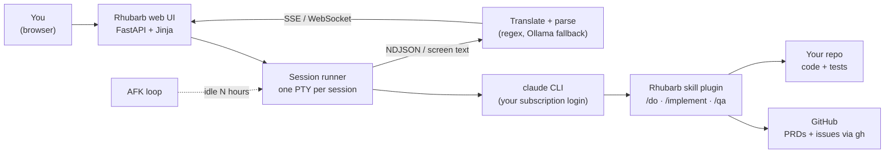

<div align="center">

# Rhubarb

**An agentic software development controller that drives Claude Code from idea to merged feature.**
Pick a project, describe what you want, and Rhubarb runs the whole loop: requirements grilling → PRD → issues → implementation → QA. It moves forward only when tests actually run and pass, not just because files exist.


[](LICENSE)

</div>

---

## Features

- **The full feature lifecycle in one place.** `/do` grills you on requirements, writes a PRD and splits it into GitHub issues. `/implement` builds the issues one at a time with tests. `/qa` checks the result against the acceptance criteria and closes everything out.
- **Real gates.** A phase passes only when its scenario-based checks pass, including tests that actually run. A generated file is not proof that anything works.
- **Answer questions in the browser.** Claude's grilling questions are parsed into question cards in the web UI, so you answer them there instead of in a terminal.
- **PRD board.** A project's open PRDs (issues labelled `prd`) are listed and sorted, with blocked ones flagged, so you can see what's next at a glance.
- **AFK mode.** If a project sees no manual activity for a set number of hours, Rhubarb starts implementing the top unblocked PRD by itself and tells you what it did when you come back.
- **Serial or parallel implementation.** Queue implementation sessions one after another per project, or let them run side by side.
- **Live terminal view.** Each session runs in a real PTY, and its output streams to the browser as it happens. You can hide the view or open a native terminal instead.
- **Model and effort control.** Switch the Claude model and reasoning effort from the settings.
- **Local AI fallback.** When a reply doesn't match the strict question parser, an optional local [Ollama](https://ollama.com) model reads it. It runs offline, and Rhubarb can install Ollama for you.
- **Uses your subscription.** Rhubarb runs the `claude` CLI under your Pro/Max/Team login. It removes any API key from the session's environment, so nothing is billed per token.
- **Error log.** A rotating, app-wide log of every session error, viewable in the UI.

## How it works



1. **Discover.** Point Rhubarb at a root folder. It finds every git repo under it that has a GitHub remote.
2. **Run a phase.** Opening a project and starting `/do`, `/implement` or `/qa` launches `claude` in its own PTY, with Rhubarb's private skill plugin. The plugin is kept separate from your global skills, so runs are repeatable.
3. **Translate.** The raw terminal output goes through a terminal emulator ([pyte](https://github.com/selectel/pyte)) to recover the text actually shown on screen. It's then turned into app events: progress, questions and results.
4. **Ask.** Questions become cards in the UI. Your answers are typed back into the live session.
5. **Publish.** PRDs and child issues are created on GitHub with `gh issue create`.
6. **Gate.** Implementation only counts once its tests run. QA then grills each feature against its acceptance criteria before closing the issues.

### Why the CLI and not the Agent SDK?

The Agent SDK requires an API key and always bills per token. Rhubarb drives the `claude` binary as a subprocess so that all reasoning runs under your Claude subscription. Because of that, it **removes** `ANTHROPIC_API_KEY` and `ANTHROPIC_AUTH_TOKEN` from every session's environment, since either would override the subscription login. The design decisions are recorded in [`CLAUDE.md`](CLAUDE.md).

## Getting started

**Requirements**
- Python 3.11 or newer
- [Claude Code](https://claude.com/claude-code) installed and logged in with a Claude subscription (`claude` on your PATH)
- [GitHub CLI](https://cli.github.com) logged in (`gh auth login`)
- Optional: [Ollama](https://ollama.com) for the local parsing fallback. Rhubarb can install it for you.

**Install**

```bash
git clone https://github.com/tarekFerdous/Rhubarb.git
cd Rhubarb
python -m venv .venv
# Windows: .venv\Scripts\activate    macOS/Linux: source .venv/bin/activate
pip install -e ".[test]"
```

**Run**

```bash
python -m uvicorn rhubarb.web.app:app
```

Open <http://127.0.0.1:8000>. Rhubarb checks that `claude` is logged in, then asks for a root folder to scan for projects.

Quick smoke test without the UI:

```bash
python -m rhubarb.main "Reply with exactly the word: pong"
```

## Settings

| Setting | What it does |
|---|---|
| **Root directory** | Folder scanned for git repos with a GitHub remote (a native folder picker is available) |
| **Model / effort** | Claude model and reasoning effort for new sessions |
| **AFK hours** | Idle time before Rhubarb implements the top unblocked PRD on its own |
| **Parallel implementation** | Off: one implementation session per project at a time, queued. On: run them side by side |
| **Terminal view** | Show or hide the live PTY output in the browser |
| **Local AI parsing** | Use or decline the Ollama fallback parser |

Settings and discovered projects are stored in a local SQLite database (Python's standard-library `sqlite3`, no extra dependency).

## Project layout

```
rhubarb/
  web/app.py            FastAPI app: pages, settings, projects, sessions, SSE/WebSocket streams
  web/templates/        login + main UI (Jinja)
  session_runner.py     per-session background jobs, phase orchestration, implement queue
  pty_engine.py         interactive PTY-backed claude driver (ConPTY on Windows, pty on Unix)
  cli_client.py         headless `claude -p` wrapper + auth-status check
  stream_translate.py   raw CLI NDJSON events → app events
  qa_parser.py          assistant replies → question cards (regex)
  ollama_rescue.py      local-LLM fallback when the regex parser can't match
  ollama_installer.py   per-OS Ollama detection and install
  afk_loop.py           idle-time self-implementation loop
  prd_list.py           sorted, blockage-annotated PRD list
  github_publisher.py   PRD drafts → GitHub issues via gh
  projects.py           repo discovery under the root directory
  db.py                 SQLite settings, projects, sessions
  error_log.py          rotating app-wide error log
  claude_plugin/        Rhubarb's private skills: do, grilling, to-prd, to-issues, implement, qa, qa-grilling
tests/                  pytest suite (445 tests)
docs/                   spikes and investigations
CLAUDE.md               architecture decisions and open questions
```

## Development

```bash
pytest            # full suite
pytest -k pty     # just the PTY engine tests
```

- Modules use pure functions with injectable external calls (subprocess, HTTP, filesystem), so most of the suite runs without `claude`, `gh` or Ollama installed.
- Record new architecture decisions in [`CLAUDE.md`](CLAUDE.md).

## Known limitations

- **Unattended sessions skip permission checks.** Headless and AFK runs pass `--dangerously-skip-permissions`, because no one is there to approve tool use. Per-session sandboxing, an audit trail and rollback are known gaps. Run Rhubarb only on repos you're comfortable letting it change.
- **Subscription usage limits.** Heavy automation across many phases can reach your plan's rolling usage cap sooner than interactive use does.
- **Single user, local only.** One browser tab talks to one backend process, with one active project at a time. It is not designed to be exposed on a network.
- **The phase and gate design is still evolving.** A fixed SDLC sequence versus configurable per-project gates is still an open question.

## License

[MIT](LICENSE) © 2026 tarekFerdous
